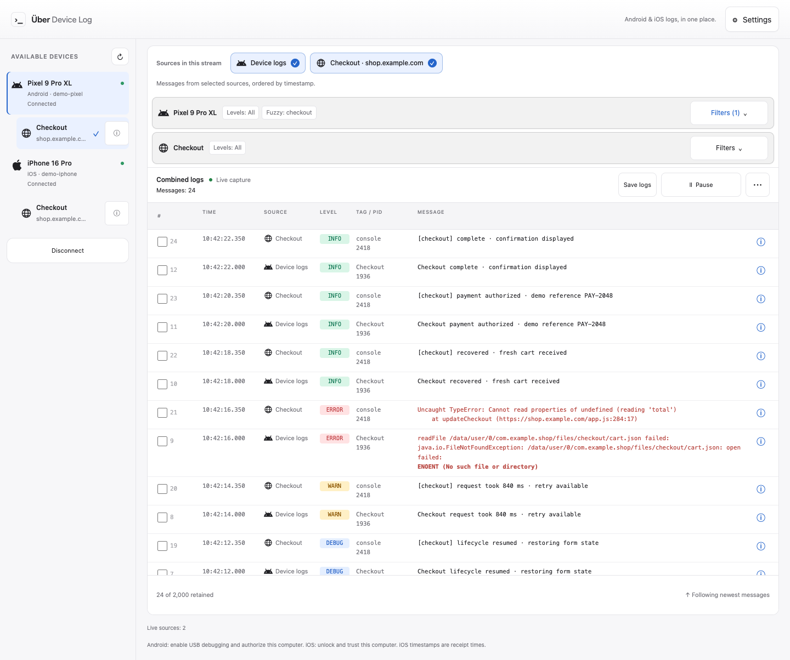

<div align="center">

# Über Device Log

[](https://www.npmjs.com/package/uber-device-log)
[](https://github.com/PMelch/uber-device-log/issues)
[](LICENSE)
[](https://nodejs.org/en/download)

**Android Logcat, iOS syslog & WebView consoles, in one place.**

A browser-based **Android Logcat, iOS syslog and WebView console viewer**,
with setup guidance for **macOS, Windows and Linux**. Connect a phone, find the message that matters,
and share the relevant entries as plain text or structured JSON.

[Website](https://uber-device-log.app) · [Get started](#get-started) · [Connect a device](#connect-a-device) · [Using the viewer](#using-the-viewer) · [Documentation](#documentation)

**Android + iOS** · **Seven languages** · **Apache-2.0**

</div>



*Actual app screenshots with fictional demo logs.*

## Less searching. More understanding.

| Find what matters | Read at your own pace | Share useful context |
| --- | --- | --- |
| Search messages, tags, timestamps and PIDs. Combine search with Android severity filters. | Pause the view, inspect formatted exceptions, and open structured message details. | Select whole entries and copy or save them as plain text or JSON. |

The responsive interface offers System, Light and Dark appearance options.

## Get started

**Minimum Node.js version: 22.12.0.** A browser and the device setup below are also required.
Node.js must be installed and available on `PATH`, including when launching with `bunx`.
Check your installed version with `node --version`.

> **Release status:** The npm package is prepared but has not been published yet.
> Until the first release, use [Run from source](#run-from-source).
> The following package commands become available after publication.

Run without a global installation:

```sh
npx uber-device-log
# or
bunx uber-device-log
```

Prefer a short command? Install once:

```sh
npm install --global uber-device-log
udl
```

Bun users can install with `bun add --global uber-device-log`, then run `udl`.
The package name is `uber-device-log`; its commands are `udl` and `uber-device-log`.

Open **http://127.0.0.1:4310** (or the URL printed in your terminal).
Press **Ctrl+C** in the terminal to stop the server.

```sh
udl --port 4311   # Choose another port
udl --help        # Show available options
udl --version     # Show the installed version
```

With a one-off launcher, use `npx uber-device-log --port 4311` or
`bunx uber-device-log --port 4311`. Both require Node.js; omit Bun's `--bun` flag.

### Run from source

```sh
git clone https://github.com/PMelch/uber-device-log.git
cd uber-device-log
npm ci
npm run dev
```

Open **http://127.0.0.1:4310**. See the [technical guide](docs/technical.md#run)
for production builds and development commands.

## Connect a device

On wide screens, choose a device from the left sidebar. On narrower screens,
use the device menu above the logs.

The app remembers the last selected device. On reload, it selects that device and
starts capture if it is connected and available. Otherwise the selection stays
empty, while the saved device is retained for a later reload. Reattaching it
during an open session does not automatically start capture.

### Android Logcat on macOS, Windows and Linux

The viewer captures Android Logcat through ADB (`adb logcat`), including severity,
tag, process ID and stack traces. Install the Platform Tools for your host OS;
Android Studio does not need to be running.

1. Install Android SDK Platform Tools and make `adb` available on your `PATH`.
2. Enable **USB debugging** on your device and connect it to your computer.
3. Accept the device's debugging authorization prompt.
4. Choose the device in **Connected device**.

Devices already visible to ADB, including Android emulators, may also appear.
If your ADB executable lives elsewhere, set `ADB_PATH` to its path.

### iOS syslog on macOS, Windows and Linux

For iPhone and iPad, the viewer reads **iOS syslog** through the legacy
`com.apple.syslog_relay` service. This provides device logs rather than full parity
with Apple’s unified logging in Console or Xcode. Available output depends on the
device and iOS version; no separate `idevicesyslog` command is required.

1. Connect and unlock your device.
2. Accept **Trust This Computer** and complete pairing.
3. Choose the device in **Connected device**.

On macOS, the app uses the system's Apple device service. Linux needs `usbmuxd`;
Windows needs compatible Apple mobile-device support. macOS is the primary
validation environment; Windows/Linux and physical-device capture still need
validation. No Appium server is required. iOS simulators are not listed.

### Android WebView consoles

Inspectable WebViews appear beneath their Android device with their page title
and URL. Select one to capture JavaScript console calls and uncaught exceptions,
or combine it with native Logcat using the source checkboxes above the stream.
Multiple WebViews can be included from the same device.

Use the Android setup above and keep the app and its WebView open. The app must
enable WebView debugging with `WebView.setWebContentsDebuggingEnabled(true)`;
the viewer cannot enable it for you. Refresh the device list if a new WebView
does not appear. Capture uses ADB and Chrome DevTools Protocol; no separate
debugging proxy or browser extension is required.

### iPhone and iPad WebView consoles

Inspectable iOS WebViews appear beneath their device with the same selection,
combined capture and per-source filtering controls as Android WebViews.

Unlock and trust the connected device, keep the app open, and enable Safari's
**Web Inspector** on the device. The app must expose its WKWebView for inspection
(`isInspectable = true` on iOS 16.4 and later). The viewer cannot enable inspection
for an app that has not opted in. Capture uses the existing USB WebInspector
service; no additional proxy, browser extension or Appium server is required.

## Using the viewer

1. **Choose your sources.** View native device logs, a WebView console, or both
   together in a stream ordered by timestamp.
2. **Find relevant messages.** Search each source independently with fuzzy or
   literal matching. Filter Android and WebView logs by severity, and native
   Android logs by exact tag or PID.
3. **Inspect what happened.** Pause the view while capture continues and inspect
   message metadata, exceptions and original text.
4. **Share the context.** Copy or save selected entries or filtered logs as plain
   text or structured JSON, preserving source identity and multiline traces.


Available in **English, Spanish, German, French, Italian, Japanese and Simplified
Chinese**, with light, dark and system appearance. Original logs remain unchanged.

See the [user guide](docs/usage.md) for selection shortcuts, filter behavior,
message details, export options and preferences.

## Good to know

- WebView capture reads console output; it does not provide JavaScript execution,
  DOM inspection or a network panel. Merged timestamps do not guarantee the exact
  causal order of events across sources.

- **Clear** empties the viewer, not the device's logs.
- The buffer defaults to **2,000 messages**, with options up to **100,000**.
  Older entries are discarded when the buffer fills. This is a viewer, not a
  lossless recorder; heavy traffic and long messages can be truncated or dropped.
- iOS uses the legacy syslog relay. It may show fewer messages than Apple Console
  or Xcode, and displayed timestamps represent receipt on your computer.
- Disconnects stop capture. Reconnect the device and click **Reconnect** to continue.
- The server listens on your computer's loopback address only. Mobile layouts
  are supported, but the app does not provide remote network access.

<details>
<summary><strong>Troubleshooting</strong></summary>

**The device is missing or unavailable**

Unlock it, check its cable, and accept its trust/debugging prompt. Refresh the device
list. For Android, check that `adb devices` lists the device as authorized. For iOS,
confirm host pairing and the required Apple device services.

**The port is already in use**

Stop the previous app process, or use `udl --port 4311`. When running from source,
set the `PORT` environment variable instead.

**`udl` is not found after installation**

Ensure your package manager's global executable directory is on `PATH`.
Bun normally uses `~/.bun/bin`. Alternatively, launch with `npx uber-device-log`.

**Some iOS logs are missing**

The legacy relay does not guarantee parity with unified logging. See the
[capture limits](docs/technical.md#behavior-and-limits) before relying on completeness.

**A WebView is missing or its console stops**

Keep the app and page open, confirm that the app has enabled inspection, and
refresh the device list. Android also needs ADB authorization; iOS needs trust,
pairing and Safari Web Inspector. A page that closes or is replaced can disappear
from discovery. Select its current target to start a fresh capture. Other enabled
sources continue capturing when one WebView stops.

</details>

## Documentation

Release notes and upcoming changes: [CHANGELOG.txt](CHANGELOG.txt).

| Guide | What's inside |
| --- | --- |
| [User guide](docs/usage.md) | Sources, filters, selection, message details, export and preferences |
| [Technical documentation](docs/technical.md) | Development setup, architecture, API, export schema and capture limits |
| [Architecture and code map](docs/architecture.md) | Data flow, module ownership, resource cleanup and state invariants |
| [API and exports](docs/api.md) | HTTP/SSE contracts, source metadata, JSON versions and limits |
| [Testing](docs/testing.md) | Coverage map, focused tests, browser fixtures and hardware checks |
| [Public website](docs/website.md) | Separate static build and deployment |
| [Contributing](CONTRIBUTING.md) | Local checks, translation requirements and change guidelines |
| [Localization](docs/localization.md) | Seven-language workflow and translation context |
| [Publishing](docs/publishing.md) | Package verification and release steps |
| [Design reference](docs/design/README.md) | Visual design and interface conventions |
| [Crash-format research](docs/crash-format-research.md) | Recognized diagnostic formats and their limits |

Found a problem? [Open an issue](https://github.com/PMelch/uber-device-log/issues)
with your host OS, device platform, app version, and steps to reproduce. Remove
private information before sharing log excerpts.

## License

[Apache License 2.0](LICENSE).
