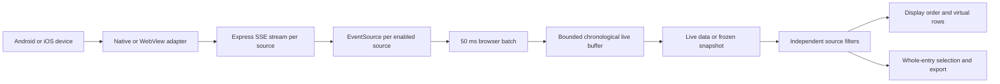

# Architecture and code map

This guide describes the current implementation. Start with [development setup](technical.md#run),
then use [API and export contracts](api.md) and [testing](testing.md) for changes.
The static public website is a separate build; see [website.md](website.md).

## Runtime and data flow

`bin/uber-device-log.mjs` validates CLI options, sets `PORT`, and imports the compiled
server in production mode. `server/index.ts` owns one HTTP server bound to
`127.0.0.1`. During development, Vite runs as middleware on that same server; in
production, Express serves `dist/`. No database or account service is involved.

The browser polls discovery every three seconds, skipping overlapping requests.
The server coalesces simultaneous discovery calls, including calls from different
tabs, but does not keep a general discovery-result cache. Android and iOS discovery
run independently through `Promise.allSettled`; one platform's failure becomes a
warning rather than hiding the other's devices. WebViews are discovered for connected
devices. Previously discovered iOS pages are retained as a fallback if a later
WebInspector discovery fails, and are discarded when the device disappears.

## Source ownership and cleanup

A browser session selects one parent device and can capture native logs and multiple
WebViews from it. Each enabled source gets its own EventSource, HTTP response,
server queue, and collector. Tabs do not share collectors. **iOS WebInspector is the
transport exception:** discovery and page collectors lease one underlying USB
connection per device within the server process.

| Module | Responsibility and constraints |
| --- | --- |
| `server/index.ts`, `server/cli-options.ts`, `bin/uber-device-log.mjs` | HTTP bootstrap, route/access validation, shutdown, CLI argument validation and production entry |
| `server/devices.ts` | Platform discovery, concurrent-request coalescing, iOS page fallback, adapter dispatch; owns raw Android logcat and iOS syslog resources |
| `server/stream.ts` | SSE framing, bounded batching, backpressure, heartbeat, connection deadline, idempotent shutdown |
| `server/webviews.ts` | Android socket enumeration, temporary loopback-to-ADB tunnels, target validation, CDP console mapping |
| `server/ios-webviews.ts` | WebInspector application/page discovery, target initialization, WebKit console mapping |
| `server/ios-inspector.ts` | Per-device connection pool, leases, sender routing, cached application list, acquisition deadline and idle disposal |
| `src/log-streams.ts` | Browser stream reconciliation, stale-callback protection, explicit retry policy, delivery batching |

The native Android adapter owns `shell('logcat -B *:V')` and passes its socket to
adbkit-logcat with `fixLineFeeds: false`. Using `openLogcat()` would change filtering
and resource ownership. Native iOS uses `com.apple.syslog_relay`; its timestamp is
host receipt time, with original device text retained.

Android WebView discovery reads `/proc/net/unix`, accepts at most 32 matching
`webview_devtools_remote` sockets, and probes them in batches of four. A temporary
loopback tunnel uses ADB `localabstract:` connections, without persistent ADB forwards.
Only page targets with a valid `/devtools/page/...` WebSocket path are accepted.
The advertised host is ignored; capture connects through the owned tunnel and
waits for `Runtime.enable` to succeed.

iOS discovery requests application/page listings; capture uses socket setup and
`Target` messages to enable `Console` for page/frame targets. It waits for console
initialization before declaring capture ready. Each lease routes addressed page
traffic by sender. Releasing a page sends its close notification without stopping
other leases. Healthy unused connections remain reusable for ten seconds; failed
discovery invalidates a connection so it closes when unused. Late connection
results are destroyed after their acquisition deadline.

Closing an SSE response stops its collector, including a collector that resolves
after the response has closed. SIGINT/SIGTERM stops active streams, closes Vite,
and closes HTTP connections. A browser stream failure explicitly closes EventSource,
preventing its built-in automatic reconnect. Reconnect or remove/re-add a source to
retry; reconnecting can replay collector history and cannot guarantee gap-free capture.

Appium's `_socketClient` and `_decoder`, USB entry points, and WebInspector wire
fields are dependency-sensitive internals. Review both iOS adapters and the pool
when upgrading `appium-ios-device`. The adbkit CommonJS bridge uses `createRequire`
because runtime exports and declarations differ on the minimum supported Node version.

## Browser state and invariants

`src/App.vue` coordinates discovery, source selection, capture state, selection,
scrolling and downloads. Keep these distinctions when changing its behavior:

- `selected` identifies the parent device. `includedKeys` identifies enabled native
  and WebView sources. `capturedSources` retains device metadata for old records,
  including after disconnect. A source key includes platform/device and, for a
  WebView, encoded socket/application and page identifiers; titles are not identity.
- Incoming records receive immutable source metadata and a unique increasing UI
  `key` before batching. The key breaks timestamp ties and anchors selection; exports
  omit it. Do not mutate retained records: timestamp, search-field and filter-match
  caches rely on immutable object identity.
- `messages` is a shallow reactive chronological array. `mergeSourceMessages` sorts
  the incoming batch and merges it with retained records, keeping the newest records
  up to capacity. Invalid timestamps precede valid ones; equal timestamps use UI keys.
  Capacity is shared by all sources, rather than reserved per source.
- `pausedMessages` is a separate immutable displayed snapshot. Pause or selection
  takes the snapshot **before** flushing queued arrivals into the live buffer, so
  those arrivals cannot evict the row being selected. Capture continues. Resume
  clears whole-entry selection, uses the live buffer, and follows its newest end.
- Source filters operate on the live data or snapshot, then display order is applied.
  `createSourceFilterer` caches matches per source and record, invalidating them when
  that source's filter signature changes. Literal search never constructs Fuse.
- Whole-entry selection and export use the complete filtered array, including
  offscreen records. Filter/capacity changes prune selected keys. Clearing selection
  leaves the snapshot frozen. Native text selection is a separate browser mechanism.
- Re-enabling a source removes that source's previous live-buffer entries before
  starting its collector, because history can replay. Picking a device or page in
  the device picker, or reconnecting, starts a fresh view. Clear discards queued and
  displayed records without clearing device logs or stopping capture.

TanStack Vue Virtual renders nearby variable-height rows with stable UI keys and
an overscan of eight. Focused rows stay mounted. Native text selection pins all
intersecting rows, which can deliberately exceed ordinary viewport row counts.
While not following, live updates preserve the visible row and pixel offset; if
retention removes that row, scrolling falls back to the nearest surviving edge.
Obsolete height measurements are periodically removed.

## Remaining module map

| Files | Responsibility |
| --- | --- |
| `shared/types.ts` | Device, WebView, source metadata and wire log types |
| `shared/notifications.ts` | Stable server notification codes, parameters and English fallbacks |
| `shared/search.ts` | Fuzzy AND-term search and literal per-field search, preserving input order |
| `shared/log-sources.ts` | Per-source filters, incremental matching and bounded chronological merge |
| `shared/log-view.ts` | Severity/PID/tag helpers, text serialization, crash/stack presentation parsing |
| `shared/log-selection.ts` | Inclusive ranges and visible selected entries in display order |
| `shared/log-export.ts` | Plain text and versioned JSON export; explicit field allowlist |
| `shared/log-details.ts` | Single-record interpretation and diagnostic JSON; never borrows neighboring metadata |
| `src/components/SourceFilters.vue` | Source-scoped search, levels and native Android metadata controls |
| `src/components/LogMessageText.vue` | Escaped text and presentation-only stack/file-failure formatting |
| `src/components/LogDetails.vue`, `src/composables/useLogDetails.ts` | One on-demand detail overlay, preview/pin timers, positioning, dismissal and focus restoration |
| `src/components/PrecisionMenu.vue`, `src/composables/useDisclosureDismissal.ts` | Keyboard navigation and outside-interaction dismissal for disclosures |
| `src/components/UserSettings.vue`, `src/composables/usePreferences.ts` | Settings UI, persistence, effective theme and system appearance listener |
| `src/preferences.ts`, `src/remembered-device.ts` | Preference validation, storage failure handling and initial device restoration |
| `src/performance.ts`, `src/composables/usePerformance.ts` | Opt-in development diagnostics and lifecycle-managed sampling |
| `src/i18n/` | Seven typed catalogs, locale resolution, message rendering, translator context, separate website catalog |
| `server/ios-types.d.ts` | Declaration bridge for the iOS package’s shipped types |
| `src/main.ts`, `src/style.css`, `index.html` | App entry, Precision styling and document shell |
| `website/`, `scripts/build-site.mjs` | Standalone static product website and its build |
| `scripts/test-package.mjs`, `scripts/test-log-performance.mjs` | Installed-archive smoke test and synthetic browser regression |
| `server/fixtures/` | Fictional crash messages and standalone WebView UI fixture; excluded from server build |

## Persistence and trust boundary

Only preferences and parent-device identity persist in localStorage. Records,
selection, source filters, page targets and capture connections do not. Storage
failures leave preferences usable for the session. Restoration occurs on the first
successful discovery after a reload and only for a connected saved device; polling
does not later start capture automatically. See [technical.md](technical.md#user-preferences)
for storage keys.

Host and Origin guards restrict the loopback server; there is no authentication
layer for remote deployment. Keep it a local utility. Log strings render through
Vue text interpolation, never HTML. Clipboard/downloads happen in the browser;
the backend does not persist captures. Device names, IDs, URLs and log text may
contain sensitive data and are preserved in relevant exports. See [API limits](api.md#limits-and-timeouts)
before treating the viewer as a recorder.
