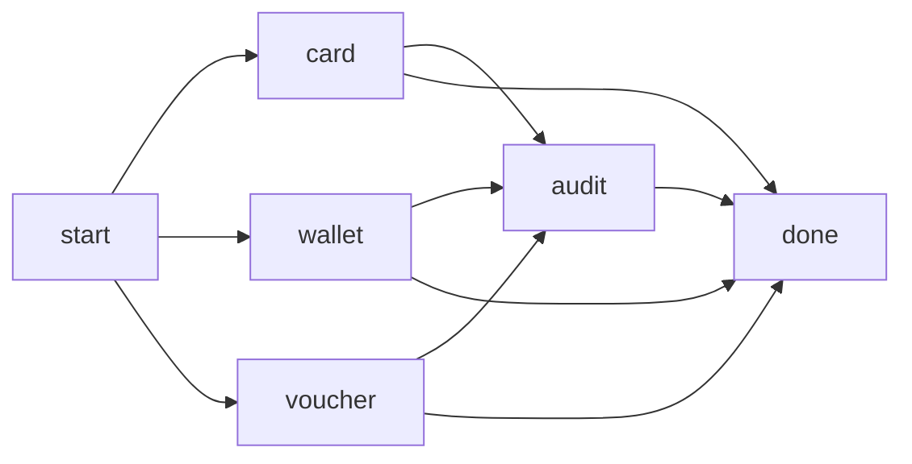

# Semantic Flows format reference

A Flow Blueprint is a YAML file that recognizes one operation from captured log messages. It defines a start, allowed steps and alternatives, identifiers that connect messages to an instance, and terminal outcomes. This reference describes the implemented **version 1** format.

Blueprints observe logs; they do not execute application code, start capture sources, or generate events. One blueprint can recognize many concurrent instances. Step names, descriptions and short labels are author-provided data and are displayed verbatim.

## Quickstart

1. In your application project, create `.udl/flows/hello.yaml` with the complete example below. The default directory needs no additional configuration. To choose another directory inside the project, set `blueprints: path/to/flows` in `.udl/config.yaml`.
2. Start the viewer with `npx uber-device-log --project=/path/to/your/app`. From a viewer source checkout, use `npm run dev -- --project=/path/to/your/app` instead. `--flows` is an alias for `--project`; both take the **project root**, not a YAML file.
3. Include the device or WebView source that emits your messages. Open **Flows → Blueprints**, select the file and use **Validate draft** before saving edits. These are the English UI labels.
4. Emit the two JSON messages below through your application's captured logger, with the same `requestId`. Open **Flows** to inspect the completed instance.

```yaml
version: 1
id: hello
name: Hello operation
start: start
timeout: 30s
correlation:
  scope: device-session
  primary: requestId
steps:
  - id: start
    name: Operation started
    match:
      json: { path: event, equals: hello.started }
    extract:
      requestId: { json: requestId, required: true }
    next: [done]
  - id: done
    name: Operation completed
    match:
      json: { path: event, equals: hello.completed }
    extract:
      requestId: { json: requestId, required: true }
    outcome: completed
```

Each line below is the entire captured **message text**, not a transport envelope:

```jsonl
{"event":"hello.started","requestId":"r1"}
{"event":"hello.completed","requestId":"r1"}
```

For example, a captured WebView console can emit `console.log(JSON.stringify({ event: 'hello.started', requestId: 'r1' }))`. Check the actual captured text: JSON matching requires the whole message to parse as JSON. A prefix such as `INFO: {"event":...}` requires text/regex matching instead.

Loading a project does not replay example logs. For a runnable emitter and more complete examples, see the [test project](../test_flow_project/README.md).

## How steps and branches work

`start` points to the initial step. After accepting that step, the engine expects the IDs in its `next` list. A matching successor replaces that list with its own successors. An `outcome` ends the instance.

**Multiple successors are alternatives, not parallel tasks.** `next: [card, wallet, voucher]` accepts one matching path. It does not wait for all three. A shared successor joins alternative routes; it is not an AND barrier. The graph must be acyclic, every step must be reachable from `start`, and at least one reachable step must have an outcome.

The order of `steps` is not execution order; `start` and `next` determine progression. Without `shortLabel`, the UI uses `S1`, `S2`, etc. from the array order. Avoid overlapping matchers among eligible alternatives: if a message matches multiple candidates, the engine marks the affected instance(s) ambiguous rather than choosing the first.

### Three alternatives and an optional step

This complete blueprint accepts card, wallet or voucher, followed by either an audit event and completion, or direct completion:



Each payment route can reach the same `done` step directly or through `audit`:

```yaml
version: 1
id: checkout
name: Checkout
start: start
timeout: 90s
correlation:
  scope: device-session
  primary: requestId
steps:
  - id: start
    name: Checkout started
    match: { json: { path: event, equals: checkout.started } }
    extract:
      requestId: { json: requestId, required: true }
    next: [card, wallet, voucher]
  - id: card
    name: Card selected
    match: { json: { path: event, equals: checkout.card } }
    extract:
      requestId: { json: requestId, required: true }
    next: [audit, done]
  - id: wallet
    name: Wallet selected
    match: { json: { path: event, equals: checkout.wallet } }
    extract:
      requestId: { json: requestId, required: true }
    next: [audit, done]
  - id: voucher
    name: Voucher selected
    match: { json: { path: event, equals: checkout.voucher } }
    extract:
      requestId: { json: requestId, required: true }
    next: [audit, done]
  - id: audit
    name: Optional audit event
    optional: true
    match: { json: { path: event, equals: checkout.audit } }
    extract:
      requestId: { json: requestId, required: true }
    next: [done]
  - id: done
    name: Checkout completed
    match: { json: { path: event, equals: checkout.completed } }
    extract:
      requestId: { json: requestId, required: true }
    outcome: completed
```

Example route: `checkout.started → checkout.wallet → checkout.completed`, all with `requestId: "r1"`. Adding `checkout.audit` before completion is also valid. Other alternatives are not missing steps.

`optional: true` does **not** add a bypass. For an optional step with successors, each predecessor must explicitly include all those successors in its own `next`. Here every payment step has both `audit` and `done`. To represent cancellation directly in the graph, use a terminal step with `outcome: cancelled` instead of `completed`.

## Complete field reference

Unknown fields are rejected, including inside nested objects. Unless stated otherwise, strings must be nonempty after trimming and at most 4,096 JavaScript string code units. Their values are not automatically trimmed for matching.

### Blueprint fields

| Field | Required | Type and behavior |
| --- | --- | --- |
| `version` | Yes | Integer `1`. |
| `id` | Yes | String; unique across active blueprint files. Independent of filename. |
| `name` | Yes | Display name. |
| `description` | No | Description shown in Info. |
| `start` | Yes | Existing step ID. Its extractor must declare the primary correlation field. |
| `timeout` | Yes | Positive integer followed by `ms`, `s`, `m` or `h`, e.g. `500ms`, `90s`, `2m`. No decimals, spaces or zero. Deadline starts when the instance is created and does not reset at each step. |
| `correlation` | Yes | Object described below. |
| `steps` | Yes | Array of 1–100 step objects. |
| `errors` | No | Array of 0–50 error rules. |

### Correlation fields

| Field | Required | Type and behavior |
| --- | --- | --- |
| `scope` | Yes | Exactly `device-session`. Recognition is scoped to the capture epoch and device. Instances retain their blueprint revision. |
| `primary` | Yes | Name of an extracted payload field used to start and identify an instance. Not automatically a path into the incoming JSON. |
| `aliases` | No | Array of at most 20 additional extracted field names that can identify the same instance. Default: none. |

Use safe property-style names for primary/alias fields, such as `requestId` and `jobId`. Correlation values must be strings, finite numbers or booleans. `null`, arrays and objects cannot start an instance or become identity bindings. Prefer strings for identifiers, especially leading zeros and integers beyond JavaScript's safe integer range.

### Step fields

| Field | Required | Type and behavior |
| --- | --- | --- |
| `id` | Yes | String unique within `steps`; referenced by edges and `equalsFrom.step`. |
| `shortLabel` | No | Display label inside the node. Keep it short; otherwise the UI uses `S` plus the array position. |
| `name` | Yes | Display name of the step. |
| `optional` | No | Boolean, default `false`; marks an optional step but does not create bypass edges. |
| `match` | Yes | Matcher object described below. |
| `extract` | No | Mapping from payload field names to extractor objects. At most 50 fields. |
| `next` | For nonterminal steps | Array of 1–100 unique existing step IDs. |
| `outcome` | For terminal steps | `completed`, `failed` or `cancelled`. Mutually exclusive with `next`, including an empty `next`. |

### Matcher fields

All specified conditions are combined with **AND**. Each matcher, including each child of `all`, needs at least one of `contains`, `regex`, `json` or `all`; metadata constraints alone are insufficient.

| Field | Required | Type and behavior |
| --- | --- | --- |
| `source` | No | `any`, `device` or `webview`. Omitted behaves like `any`. Filters already included sources; does not enable capture. |
| `platform` | No | `ios` or `android`, compared to source metadata. |
| `tag` | No | Exact, case-sensitive match against the log record's tag. |
| `level` | No | Exact, case-sensitive match against the log record's level, e.g. `ERROR`. String, not a special enumeration in this format. |
| `contains` | No | Case-sensitive literal substring of the original message text. |
| `regex` | No | JavaScript regular-expression pattern string, without `/.../` delimiters or a separate flags field. |
| `json` | No | Object with `path` and exactly one of `equals` or `equalsFrom`. |
| `all` | No | Array of 1–20 matcher objects; every child must match. Nested matcher depth is limited to 12 below the root. |

| `json` field | Required | Type and behavior |
| --- | --- | --- |
| `path` | Yes | Safe dot-separated path in the parsed message, e.g. `payload.transactionId`. |
| `equals` | Exactly one comparison | String, number, boolean or `null`; strict equality without coercion. Missing properties do not match, even when comparing to `null`. |
| `equalsFrom` | Exactly one comparison | Object with required `step` and `field` strings, referring to a previous step's extracted payload field in the same instance. |

`equalsFrom.step` must precede the consumer on **every** incoming route. Its extractor must declare `equalsFrom.field`. The engine requires an accepted observation with a string, finite number or boolean value, and compares it strictly with the incoming JSON value. Referencing an optional producer that can be bypassed is invalid. The extractor need not be marked `required` for validation to pass, but if its value was absent the comparison cannot match. Error-rule matchers do not support `equalsFrom`.

Safe paths follow `[A-Za-z_$][\w$]*` per segment separated by dots. Segments `__proto__`, `prototype` and `constructor` are forbidden. There are no array indexes, wildcards, JSONPath expressions or executable expressions. Extraction field names use the same validation; prefer simple names. A dotted extraction name is a literal payload key, not a nested object created by the engine; correlation and `equalsFrom.field` refer to that exact key.

There is no `any`, `or`, `not`, numeric range or regex-flags operator. Use distinct successor steps for alternative events, or a supported regular expression where appropriate. `source: any` is a source selector, not an OR operator.

### Extractor fields

`extract` maps output names to extractor specifications. `extract.requestId.json: request.id` reads `request.id` from the incoming JSON and stores it as payload field `requestId`.

| Field | Required | Type and behavior |
| --- | --- | --- |
| `json` | Exactly one source | Safe dot-separated path into the parsed message. Preserves the JSON value's type, including objects, arrays and `null`. |
| `regex` | Exactly one source | JavaScript regex pattern applied to original message text. Requires `group`. Extracted captures are strings. |
| `group` | With `regex` | Name of an existing named capture, e.g. `requestId` for `(?<requestId>...)`. Numeric capture indexes are unsupported. Forbidden with a JSON extractor. |
| `required` | No | Boolean, default `false`. If no value is extracted (`undefined`), the entire candidate is rejected. A JSON `null` counts as present, although it cannot be an identity or `equalsFrom` value. |
| `sensitive` | No | Boolean, default `false`. Masks the extracted field in the inspector until revealed; it does not remove the value from memory or the captured log. |

Regex matching uses the JavaScript engine. The validator checks syntax and named captures, not runtime complexity. Prefer simple, anchored patterns; there is no per-pattern execution timeout in the blueprint format. Single-quoted YAML strings preserve backslashes conveniently.

### Error rule fields

| Field | Required | Type and behavior |
| --- | --- | --- |
| `id` | Yes | String unique among error rules. Use an ID distinct from step IDs too, to keep inspection clear. |
| `appliesTo` | Yes | `active`, or a nonempty list of existing step IDs. A listed ID applies if it is currently expected **or** is the most recently observed step. |
| `match` | Yes | Matcher object, without `equalsFrom`. |
| `extract` | Yes in practice | Extraction mapping; must declare the field named by `codeField`. Also extract a known primary/alias ID to identify the instance. |
| `codeField` | Yes | Exact extracted field name containing the error code. |
| `codes` | Yes | Mapping from code strings to objects with `description` and `outcome`. May be empty. The extracted value is converted to a string for lookup. |
| `codes.<code>.description` | Yes | Nonempty description displayed with the error. |
| `codes.<code>.outcome` | Yes | `failed` or `cancelled`. |
| `unknownOutcome` | Yes | `failed` or `cancelled`, used for unmapped codes. |

Error rules are evaluated before ordinary expected steps. A unique matching, correlated rule ends the instance and clears expected steps. Multiple matching candidates cause ambiguity, not first-rule-wins behavior. Errors do not independently start instances and have no keyless fallback. They need a known matching correlation binding. If `codeField` is not `required`, a missing code also takes `unknownOutcome`; use `required: true` when missing codes should reject the candidate.

## Correlation and error handling example

Here `requestId` starts a job. An accepted bridge event contains both `requestId` and a new `jobId`, establishing an alias. The submission event is identified using `equalsFrom`; completion and errors use the alias.

```yaml
version: 1
id: job
name: Background job
start: start
timeout: 2m
correlation:
  scope: device-session
  primary: requestId
  aliases: [jobId]
steps:
  - id: start
    name: Request started
    match: { json: { path: event, equals: job.started } }
    extract:
      requestId: { json: requestId, required: true }
    next: [accepted]
  - id: accepted
    name: Server assigned a job ID
    match: { json: { path: event, equals: job.accepted } }
    extract:
      requestId: { json: requestId, required: true }
      jobId: { json: jobId, required: true }
      token: { json: token, sensitive: true }
    next: [submitted]
  - id: submitted
    name: Job submitted
    match:
      all:
        - json: { path: event, equals: job.submitted }
        - json:
            path: jobId
            equalsFrom: { step: accepted, field: jobId }
    next: [done]
  - id: done
    name: Job completed
    match: { json: { path: event, equals: job.completed } }
    extract:
      jobId: { json: jobId, required: true }
    outcome: completed
errors:
  - id: job_error
    appliesTo: active
    match: { json: { path: event, equals: job.error } }
    extract:
      jobId: { json: jobId, required: true }
      code: { json: code, required: true }
    codeField: code
    codes:
      USER_CANCELLED:
        description: The user cancelled the job.
        outcome: cancelled
      FAILED:
        description: The server could not finish the job.
        outcome: failed
    unknownOutcome: failed
```

Happy path, with no `requestId` after the bridge:

```jsonl
{"event":"job.started","requestId":"r1"}
{"event":"job.accepted","requestId":"r1","jobId":"j1","token":"example-only"}
{"event":"job.submitted","jobId":"j1"}
{"event":"job.completed","jobId":"j1"}
```

Instead of submitting/completing, send `{"event":"job.error","jobId":"j1","code":"USER_CANCELLED"}` after acceptance to produce `cancelled`. `FAILED` produces a known failure description; `NEW_CODE` produces `failed` without a mapped description. This rule cannot identify an error before `jobId` is learned; an initialization-error rule should extract the already-known `requestId` instead.

Correlation is based on **extracted field names and values**, not on similar text or arbitrary JSON identifiers. For correlation through extracted IDs, at least one known identity binding must match. A successful `equalsFrom` comparison can identify an instance without an extracted ID, as in `submitted` above. Any supplied binding that conflicts with an existing binding rejects that candidate. Accepted bridge steps can add aliases. Alias collisions between active instances are marked ambiguous. Do not reuse a user/account ID as an operation ID when concurrent operations are possible.

A normal expected step with **no primary or alias extractor declared** can also advance a unique waiting candidate without an identifier. This is a fallback for distinctive keyless log events, not a concurrency guarantee: multiple eligible candidates become ambiguous and do not advance. Declaring an identity extractor but omitting its value does not activate this fallback. Prefer explicit IDs or `equalsFrom` whenever available. Ambiguous instances are not subsequently resolved automatically by another ordinary progression event.

## Text and regex example

For messages such as `job.start request=r1` and `job.done request=r1`, use a named capture rather than JSON paths:

```yaml
version: 1
id: text-job
name: Text job
start: start
timeout: 30s
correlation:
  scope: device-session
  primary: requestId
steps:
  - id: start
    shortLabel: IN
    name: Text request started
    match: { contains: 'job.start request=' }
    extract:
      requestId:
        regex: '^job\.start request=(?<requestId>[A-Za-z0-9_-]+)$'
        group: requestId
        required: true
    next: [done]
  - id: done
    shortLabel: OUT
    name: Text request completed
    match: { regex: '^job\.done request=' }
    extract:
      requestId:
        regex: '^job\.done request=(?<requestId>[A-Za-z0-9_-]+)$'
        group: requestId
        required: true
    outcome: completed
```

The regex extractor and matcher are separate checks. Here a partial `contains` match still needs the full extractor pattern to succeed because `requestId` is required.

## Timeouts and incomplete evidence

Only `completed`, `failed` and `cancelled` are writable YAML outcomes. `running`, `timed_out` and `interrupted` are runtime states.

- The deadline uses the engine's receipt clock, not timestamps embedded in log text. A timeout means the expected terminal evidence was not observed in time, not proof of an application failure.
- Timed-out instances can still accept eligible late evidence in the same capture epoch. A later terminal result is stored as `lateOutcome`; it does not change `timed_out` to `completed`.
- Unresolved relevant records are buffered for reordering. The engine retries them and expires them on a tick after more than two seconds; this window is bounded by queue limits and is not configurable in YAML.
- A recognizable non-start step with an identity may create a `missing_start` instance after that window. Reaching a `completed` terminal then yields `interrupted`, not a proven complete run. Ineligible steps on an existing instance may be retained as unaccepted evidence (`missing_steps`); their extracted values cannot satisfy later references.
- Source/session changes interrupt running instances. Capture gaps, truncated records and ambiguity affect completeness separately from the outcome. Missing or excluded sources cannot be inferred from a blueprint or automatically captured.

## Files, validation and limits

Put active `.yaml` or `.yml` files directly in the configured directory; scanning is not recursive. Files ending in `.draft.yaml` or `.draft.yml` are ignored. Filenames for active files must start with an ASCII letter or digit, followed by at most 119 letters, digits, dots, underscores or hyphens, then `.yaml` or `.yml`. The directory must remain inside the project; symlink directories and blueprint files are rejected.

An invalid active set is not partially activated. On a failed reload the last valid definitions remain active and diagnostics describe the current files. Existing instances keep the revision with which they started. A valid single draft can still fail saving if its ID duplicates another active blueprint ID.

| Limit | Implemented value |
| --- | --- |
| Active files | 100 |
| File size on disk and save | 256 KiB |
| YAML structure | At most 12,000 visited nodes; depth at most 32 |
| Steps per blueprint | 1–100 |
| Successors per step | 1–100 unique IDs |
| Error rules per blueprint | At most 50 |
| Extracted fields per step/error rule | At most 50 |
| Correlation aliases | At most 20 |
| Children per `all` | 1–20 |
| Nested matcher depth | At most 12 below root |

Duplicate YAML keys, aliases, unsupported tags, unknown fields, unreachable steps, cycles, invalid edge targets and invalid `equalsFrom` dependencies are rejected. Use ordinary YAML mappings, lists and scalar values. There is no embedded JavaScript, interpolation syntax, retry-loop edge, parallel join, automatic optional-step skipping or separate flow-validation CLI subcommand.

Validate in the editor, or use [`POST /api/flows/validate`](api.md#semantic-flows) with the local capability token. An HTTP 200 validation response can contain diagnostics; validity means the diagnostics array is empty. For a viewer source checkout, this command validates one file without starting a server:

```sh
node --import tsx --input-type=module - /path/to/hello.yaml <<'JS'
import { readFile } from 'node:fs/promises';
import { parseFlowBlueprint } from './shared/flow-blueprints.ts';
const filename = process.argv[2];
const result = parseFlowBlueprint(await readFile(filename, 'utf8'), filename);
console.log(JSON.stringify(result.diagnostics, null, 2));
process.exitCode = result.diagnostics.length ? 1 : 0;
JS
```

This checks one blueprint's format and graph, not cross-file uniqueness or whether your application emits the expected messages. Test with actual captured messages and cover each alternative, cancellation, unknown error, timeout and concurrent operation you expect.

## Implementation and further reading

- [Types](../shared/flow-types.ts), [validator](../shared/flow-blueprints.ts), [recognition engine](../shared/flow-engine.ts) and [project loader](../server/flow-project.ts) define the current contract.
- [Reference example tests](../server/flow-format-docs.test.ts) validate all four complete YAML examples above and replay their routes, including concurrent jobs and unknown errors. Run `node --import tsx --test server/flow-format-docs.test.ts` from the viewer checkout.
- [Example project](../test_flow_project/README.md) provides purchase, login and asset-download definitions plus an emitter.
- [Extraction guide](semantic-flows-agent-guide.md) explains how to derive definitions from application code and verify emitted log formats.
- [API documentation](api.md#semantic-flows) covers validation, saving and revision conflicts.
