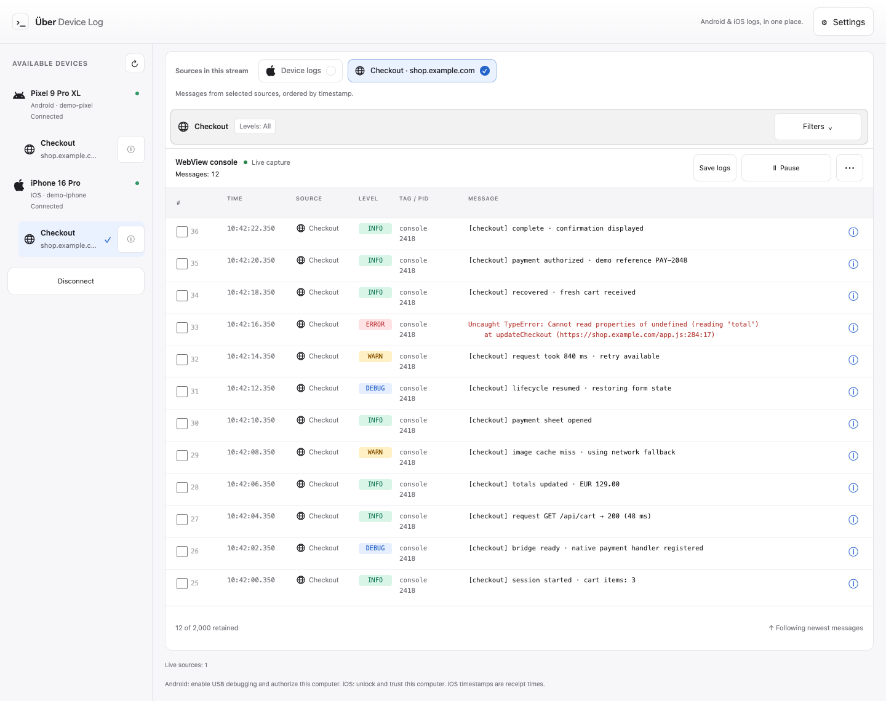
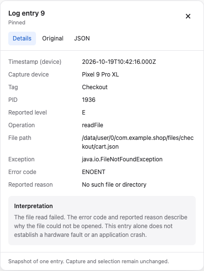
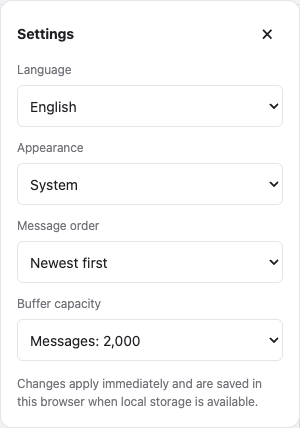

# Using Über Device Log

For installation and device setup, see the [README](../README.md#get-started).

## Find a message

Each source row shows a compact summary of its current filters. **Levels: All**
means severity is unrestricted; **No levels** means no severity is selected.
Long filter values remain available in the summary tooltip and filter panel.

Open **Filters** on a source and type in its search field to search message text and metadata. Use Android
and WebView severity buttons to narrow the view further. Native iOS syslog does
not provide severity filtering. Change **Message order** in **Settings** to show
newest entries first or last. Scrolling away stops automatic following;
**Follow latest** resumes it.

Choose **Fuzzy search** for typo-tolerant matching or **Literal search** for a
case-insensitive, contiguous phrase in a single message or metadata field.
Literal search treats punctuation as text, without regular expressions.
For native Android logs, open **Filters** and expand **Advanced filters**. **Exact Android tag** matches
the entire tag with case sensitivity;
**Exact Android PID** matches the numeric process ID. Combine these with search
and severity filters. Invalid PIDs show a validation message and no results.
**Reset filters** clears search, tag, PID and severity restrictions while keeping
the chosen search mode. These controls only filter the view; capture continues,
and Copy/Save use the displayed filtered entries.

## Combine device and WebView logs

Select a device or WebView, then enable the desired sources above the stream.
The source chips combine native logs and one or more WebView consoles from
the selected device. Each source has independent search and severity controls
(except native iOS syslog); native Android logs also have exact tag and PID
filters. Entries merge by timestamp and show the
platform or WebView icon beside their source. A stopped WebView does not stop
the other sources. Re-enabling a source replaces its previous buffer with the
new capture, since collectors can replay their history.

Selecting a device or WebView in the device list starts a fresh view with that
source alone. WebViews show a compact title and domain; their **ⓘ** button opens
the complete URL and target identifier. Use the source chips to add other sources. Only the parent device
is remembered across reloads; WebView page targets are temporary.

WebView console timestamps come from CDP on Android and WebKit on iOS, with host
receipt time as a fallback. Native iOS syslog uses host receipt time, so merged
timestamps do not guarantee the exact causal order of device events.

WebView capture reads console output. It does not offer JavaScript execution,
expandable object inspection, a DOM inspector or a network panel.

Exports retain source identity: plain text prefixes each entry with its source
name, and structured JSON uses schema version 2 with source metadata per entry.

## Pause, inspect, resume

**Pause** freezes the view while capture continues. **Back to live** resumes the view and clears your selection. The paused
arrival counter includes all incoming records, even those already evicted from the
buffer. Resuming displays only the retained records.

Hover over an entry's **ⓘ** button to inspect its metadata and interpretation.
Click or tap **ⓘ** to pin the details open, including an existing hover preview.
The card offers **Details**, **Original**, and **JSON** views. Click the info button
again, press **Escape**, or use **×** to close it. Scrolling the list or selecting a row also closes it.
Explanations describe patterns in the message; they are not definitive diagnoses.

## Copy or save

Drag directly over message text for native text selection. This freezes the
view while capture continues, including on touch devices.

1. On touchscreens, tap **Select** first. On desktop, use checkboxes, **Shift-click** to extend,
   or **Ctrl/Cmd-click** to toggle. Drag outside message text to select a range.
2. Open **More actions** (•••) and choose **Plain text** or **Structured JSON**.
3. Click **Copy** or **Save logs** in the toolbar. On narrow screens, saving is
   available in **More actions**.

Selecting entries freezes the view so you can work without incoming messages
moving the selection. **Select all filtered** in **More actions** selects the current results.
Without a selection, **Save all displayed logs** saves the filtered view.
Exports preserve whole entries, metadata and multiline messages, always oldest first regardless of the display order.

## Choose your language

**English · Español · Deutsch · Français · Italiano · 日本語 · 简体中文**

Open **Settings** in the header to choose your language, appearance, message order,
and buffer capacity. All four preferences are saved locally in this browser;
System appearance follows your operating system. Changes apply immediately, and
remain usable for the session if browser storage is blocked.

Your preferences survive reloads; captured logs are not saved. As always,
original log messages and technical values are never translated.

